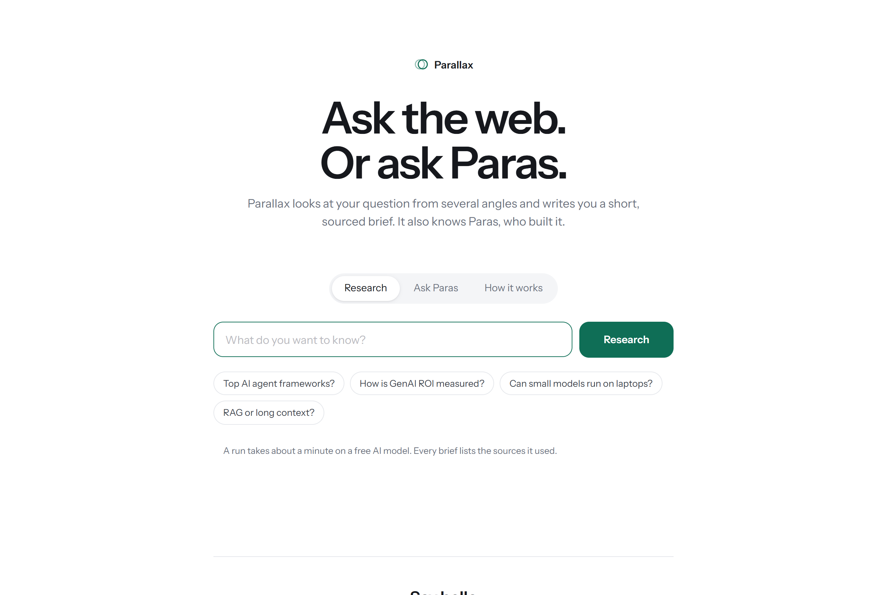
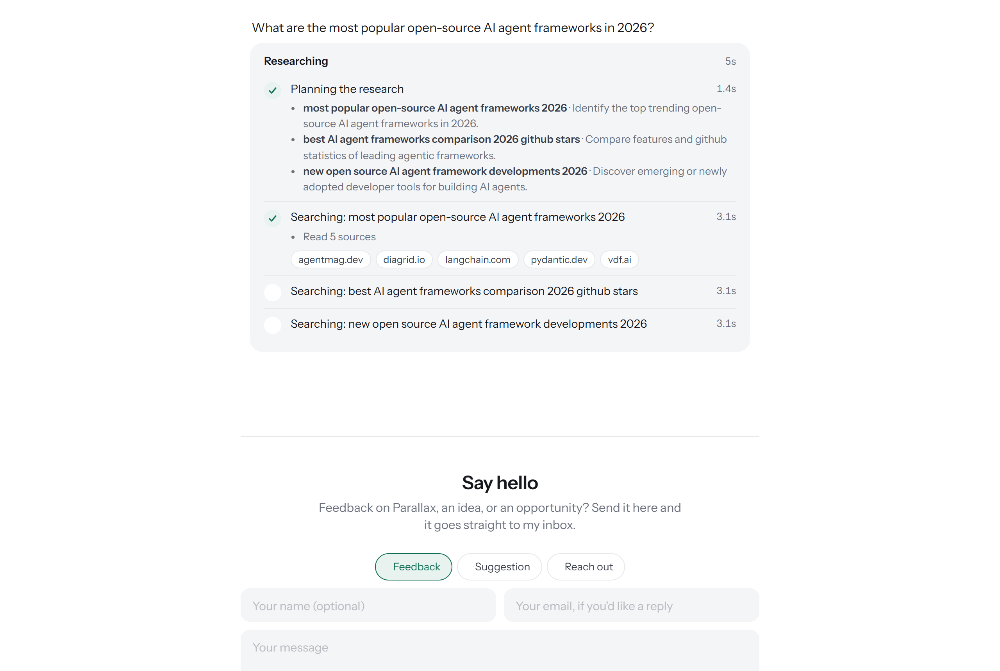
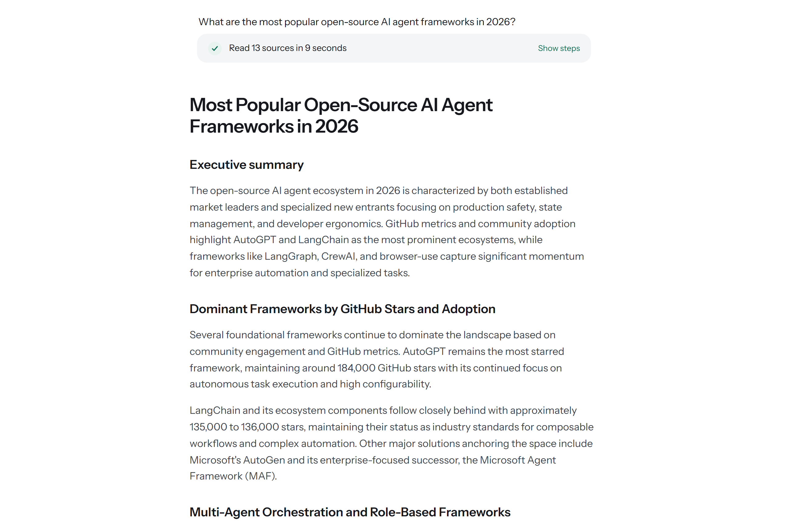
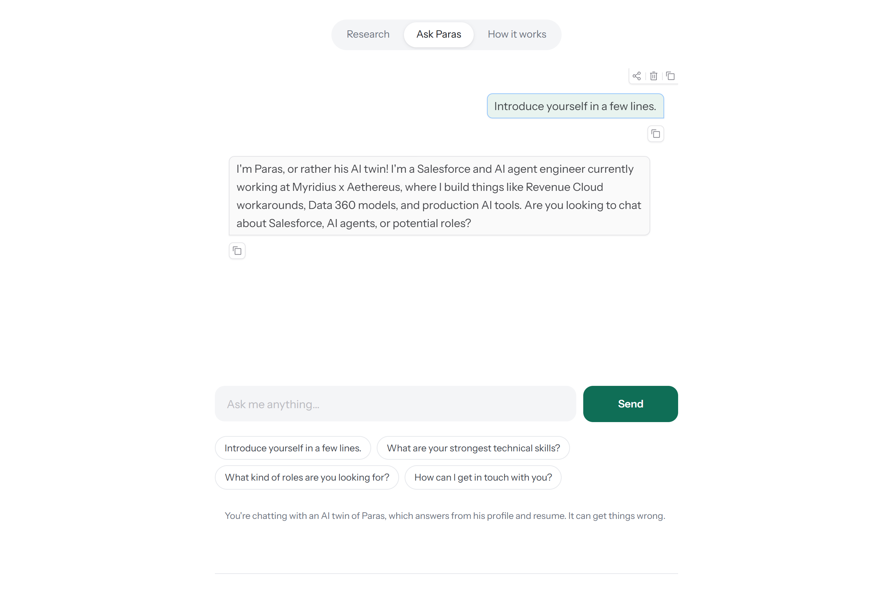
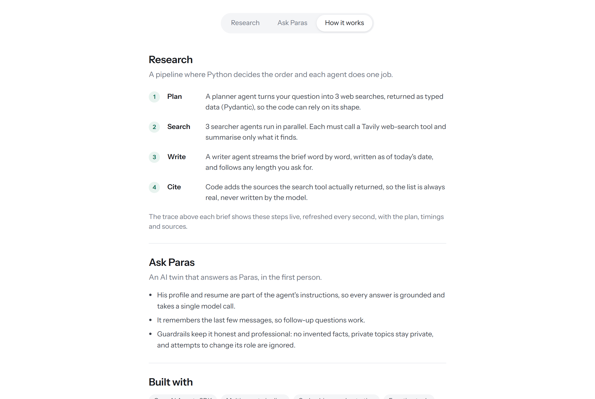
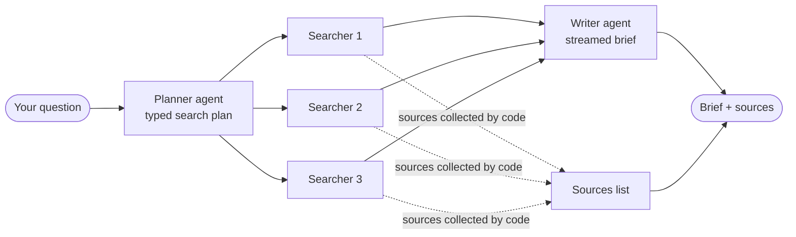

# Parallax

**A personal AI workspace: a multi-agent research tool and an AI twin, built to keep growing.**

Parallax does two things today:

- **Research.** Ask any question. A small team of agents plans the searches, reads the web in parallel, and writes a short, sourced brief, while you watch every step happen live.
- **Ask Paras.** Chat with an AI twin of me. It answers in the first person about my work, skills and goals, grounded only in my own profile and resume.

It runs entirely on free infrastructure: Google's free `gemini-3.5-flash-lite` model, Tavily's free search tier, and free hosting. That constraint shaped almost every design decision below.

> **Live demo:** [parallax-hjsn.onrender.com](https://parallax-hjsn.onrender.com) (free hosting: the first visit after a quiet spell can take up to a minute to wake up) · Built by [Paras Agarwal](https://www.linkedin.com/in/parasagarwal-dev)



| Watching the agents work | The finished brief |
|---|---|
|  |  |
| **Chatting with the AI twin** | **How it works, on the page** |
|  |  |

---

## Why I built it

I'm a Salesforce developer who got curious about how AI agents actually work, and the fastest way I know to understand something is to ship it. Parallax started as a lab exercise while learning the OpenAI Agents SDK and grew into the place where I put what I learn into practice.

The name is the idea. *Parallax* is what you get when you look at the same thing from more than one viewpoint. The research tool does exactly that: it looks at your question from several angles before writing anything. The name also starts with "Para", which is a small nod to me.

It is meant to keep growing. Next on the list are more agent frameworks, and connecting agents to real Salesforce orgs (more on that in the [roadmap](#roadmap)).

## Design principles

These are the ideas I kept coming back to while building it:

1. **Let code decide what's predictable; let the model decide what isn't.**
   Research always follows the same steps, so Python orchestrates them, and the agents only do the thinking inside each step. Conversation is open-ended, so the twin is a single, free-running agent.
2. **Small model, small jobs.**
   A free, lightweight model is reliable when each agent has one narrow task, clear instructions and a typed output. It gets unreliable when one agent has to do everything.
3. **Facts come from code, not from the model.**
   Every source in a brief is collected by the search tool itself and added by code. The model never writes a citation, so it can't invent one.
4. **Never leave someone staring at a frozen screen.**
   Free models can be slow. Parallax shows its plan, timings and sources as they happen, and keeps the page moving even while it waits.
5. **Fail politely, never silently.**
   Rate limits, overloaded servers and empty results all produce a clear, human message that says what happened and what to do.
6. **Be honest about limits.**
   The page says it runs on a free model, the twin says it's an AI when asked, and visitors are told what gets logged.

## How it works

### Research: a code-orchestrated multi-agent pipeline



1. **Plan.** The planner agent turns the question into three web searches, each with a short reason. It returns *structured output* (a Pydantic model), so the code receives a guaranteed shape rather than free text to parse. Its instructions are rebuilt on every run with **today's date**, so "latest" really means latest, not the model's training year.
2. **Search.** Three searcher agents run **in parallel**. Each one is required to call a web-search tool (Tavily) and summarise only what the results say. If a page says nothing useful, the agent reports that instead of filling the gap.
3. **Write.** The writer agent turns the summaries into a professional brief and streams it onto the page word by word. By default it writes a structured report; if you ask for "50 words" or "three bullets", your request takes priority.
4. **Cite.** While searching, the tool quietly records every page it read in a shared *run context*. Code removes duplicates and appends them as the sources list.

A **live activity panel** shows each step as it runs: the plan with its reasons, each search with its timer and source domains, then the writing. Slow calls run as background tasks while the page refreshes every second (a "heartbeat"), so timers keep ticking even while the model is thinking. When the brief is done, the panel folds into a single line so the reading starts higher up the page.

### Ask Paras: a grounded AI twin

The twin is a single agent that speaks as me, in the first person. My profile and resume are loaded into its instructions once at startup, so every answer takes **one model call**, with no lookups that could slow it down or fail.

I started with a tool-calling version, where the agent fetched my resume only when needed. It worked, but it felt mechanical ("reading the resume…") and added extra steps that could fail. For a few pages of personal context, putting it straight into the instructions turned out to be simpler, faster and more natural.

Its instructions set out how it should behave:

- **Grounded:** every fact must come from the profile or resume.
- **Never a dead end:** if something isn't covered, it gives the most helpful honest answer it can ("I haven't used that yet, but it's on my learning plan").
- **Boundaries:** private topics stay private, salary questions go to me directly, and attempts to change its role are ignored.
- **Memory:** it keeps the last few messages for follow-ups, trimmed so long conversations stay cheap.

### Messages and activity log

A "Say hello" box lets visitors send feedback, suggestions or a note. Messages, research questions and chats go to a **Google Sheet through a small Google Apps Script**, which also emails me when someone writes. It's free, it stores everything permanently (unlike the free host's disk, which is wiped when the server sleeps), and nothing slows the visitor down: activity is logged in the background, and a logging failure never breaks the app. Messages are rate-limited per visitor, and a site-wide daily cap keeps the email quota safe.

## Key decisions and trade-offs

| Decision | Why | Trade-off |
|---|---|---|
| Python orchestrates research, not an LLM manager | Same steps every time: predictable, cheaper, easy to debug | Less flexible for unusual questions |
| Structured output for the plan | Code can rely on the plan's shape and cap the number of searches | A small model occasionally returns invalid JSON (handled with a retry message) |
| Sources collected by code | Citations are always real | The brief can't cite specific sentences to specific sources |
| Date-aware instructions | Stops the model defaulting to its training year | Instructions are rebuilt on every run (negligible cost) |
| Twin knowledge in the prompt, not via tools | One call, faster, more natural, fewer failure points | Doesn't scale to large knowledge bases (fine for one person) |
| Heartbeat updates every second | The page never looks frozen, even when the model is slow | More frequent page updates |
| Google Sheet + Apps Script for logs | Free, permanent, readable anywhere, emails built in | Around 100 emails a day on a personal Gmail account |
| One free model everywhere | Zero running cost | Shorter, less nuanced writing than a frontier model |

## What I learned along the way

Most of the design came from things that didn't work the first time:

- **"Latest" meant 2024.** The planner kept searching for older years, because the model assumes it's still its training year. Fix: give it today's date on every run.
- **"In 50 words" produced 600 words.** A small model follows its fixed instructions over a request buried in the input. Fix: tell it explicitly, and early, that the visitor's format wins.
- **The progress panel felt frozen.** Timers only updated when a step finished. Fix: run slow calls in the background and refresh on a heartbeat.
- **The twin felt like a search engine.** Visible "looking things up" notes broke the conversation. Fix: ground it in the prompt and let it talk like a person.
- **Free-tier reality.** The larger free model was often overloaded, so Parallax uses the lighter one throughout, retries automatically, and explains clearly when it has to wait.

## Tech stack

- **Agents:** [OpenAI Agents SDK](https://openai.github.io/openai-agents-python/) (agents, function tools, structured outputs, streaming, run context)
- **Model:** Google Gemini `gemini-3.5-flash-lite` through its OpenAI-compatible API
- **Web search:** [Tavily](https://tavily.com) API
- **UI:** [Gradio](https://gradio.app) with custom HTML and CSS
- **Language and tooling:** Python 3.12, asyncio, Pydantic, httpx, uv
- **Logging:** Google Sheets + Google Apps Script
- **Hosting:** Render (free tier)

## Project structure

```
app.py              Gradio app: layout, event wiring, input checks
config.py           model, limits, owner details, friendly error messages
ui.py               theme, CSS and the HTML for the hero, live trace, "How it works" and message box
research/
  planner.py        planner agent + the typed search plan
  searcher.py       searcher agent + the Tavily web-search tool
  writer.py         writer agent (streamed)
  manager.py        the orchestration: plan, parallel search, write, cite, live progress
about/
  knowledge.py      loads the profile and resume
  agent.py          the AI twin
logbook.py          sends messages and activity to the Google Sheet in the background
limits.py           message limits for the "Say hello" box
apps_script/        Code.gs: the Google Apps Script that writes the Sheet and sends emails
me/                 personal files (not in the repo); see profile.example.md
```

## Run it locally

Requires Python 3.12+ and [uv](https://docs.astral.sh/uv/).

```bash
git clone https://github.com/ParasAagarwal/parallax.git
cd parallax
uv sync                 # creates .venv and installs everything
```

Create a `.env` file:

```
GOOGLE_API_KEY=...         # Google AI Studio (free)
TAVILY_API_KEY=...         # tavily.com (free tier)
PARALLAX_LOG_URL=...       # optional: Apps Script web app URL (see below)
PARALLAX_LOG_TOKEN=...     # optional: any long random string, also pasted into Code.gs
```

Add the twin's knowledge: copy `me/profile.example.md` to `me/profile.md` and fill it in, and add `me/resume.pdf` (or `me/resume.md` as plain text). Then:

```bash
uv run app.py
```

Without the personal files, research still works and the twin simply has less to say. Without the logging settings, logging is switched off and the message box points visitors to email instead.

## Deploy on Render (free)

1. Create a **Web Service** from this repo (runtime: Python 3).
2. **Build command:** `pip install -r requirements.txt`. **Start command:** `python app.py`.
3. **Environment:** `GOOGLE_API_KEY`, `TAVILY_API_KEY`, and optionally `PARALLAX_LOG_URL` and `PARALLAX_LOG_TOKEN`.
   The Python version comes from `.python-version`, and the app listens on the `PORT` Render provides.
4. **Secret Files:** add `profile.md` and `resume.md` (plain text). Render places them in `/etc/secrets/`, which is one of the places Parallax looks.

`requirements.txt` pins exact versions; regenerate it after changing dependencies with
`uv export --no-hashes --no-dev --no-emit-project -o requirements.txt`.

The free tier sleeps after 15 minutes without visitors, so the first visit after a quiet spell takes up to a minute while it wakes up. The page says so.

## Logging setup (optional, free)

1. Create a Google Sheet in the account that should receive the emails.
2. **Extensions → Apps Script**, and replace the editor's contents with `apps_script/Code.gs`.
3. Generate a token (`python -c "import secrets; print(secrets.token_urlsafe(24))"`) and paste it into `TOKEN` at the top of the script. Save.
4. **Deploy → New deployment → Web app**, with Execute as **Me** and access **Anyone**. Approve the permissions; Google warns that the app is unverified because it's your own script.
5. Put the web app URL (ending in `/exec`) and the token in `PARALLAX_LOG_URL` and `PARALLAX_LOG_TOKEN`.
6. After editing the script later: **Deploy → Manage deployments → Edit → New version**, or the old code keeps running.

By default only visitor messages are emailed; research and chats are just logged. Set `EMAIL_EVERYTHING = true` in the script to be emailed for everything. Each visitor can send 5 messages per 24 hours, at least 5 seconds apart, and the site accepts at most 80 a day. A visitor is recognised by a hash of their IP address that is kept only in server memory and never logged.

## Roadmap

- **Salesforce integration:** agents that work with a real Salesforce org, such as querying records, summarising accounts and drafting updates, likely through MCP and the Salesforce APIs. This is the main reason for moving beyond free models in future.
- **More frameworks:** rebuild parts with CrewAI, LangGraph, Google ADK and Pydantic AI to compare approaches side by side.
- **Model switching:** use a stronger model for writing while keeping the cheap one for planning and search.
- **Evaluation:** a small test set to measure research quality and twin accuracy as things change.
- **Longer memory:** conversation summaries so the twin stays coherent over long chats.

## Limitations

- Briefs are only as good as the top search results and a small model's summary of them; they're a fast starting point, not a final source.
- Free-tier rate limits mean busy moments can need a retry.
- Message limits are kept in memory, so they reset when the free server restarts.

---

Built by **Paras Agarwal**: [LinkedIn](https://www.linkedin.com/in/parasagarwal-dev) · [GitHub](https://github.com/ParasAagarwal)
